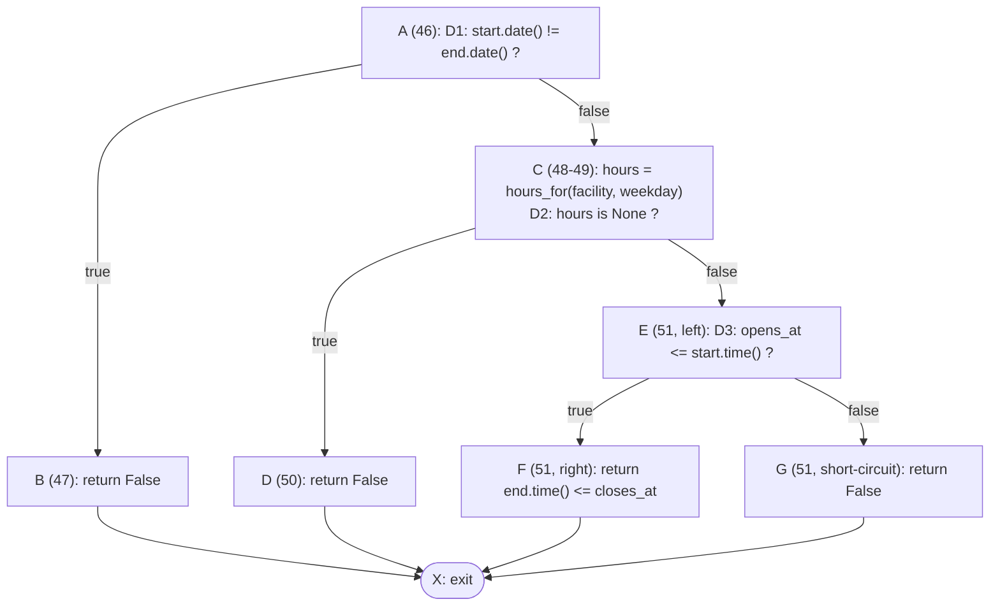

# White-box analysis: `SqlFacilityLookup.is_within_hours` (Muhammad Bilal, M2 SE431)

Method under test: `SqlFacilityLookup.is_within_hours(facility_id, start, end)` in
`app/facilities/lookup.py`, lines 41-51 (commit `e8b1959`). The booking service calls it before
every booking and approval to decide whether `[start, end)` lies inside the facility's opening
window (FR-03, FR-05). It is the most complex method in `app/facilities` by Radon (A, 4).

## 1. Source with line numbers

```python
 41     def is_within_hours(self, facility_id: int, start: datetime, end: datetime) -> bool:
 46         if start.date() != end.date():                                     # D1
 47             return False
 48         hours = self._facilities.hours_for(facility_id, start.weekday())
 49         if hours is None:                                                  # D2
 50             return False
 51         return hours.opens_at <= start.time() and end.time() <= hours.closes_at   # D3
```

Lines 42-45 are the docstring.

## 2. Decision nodes

| Id | Line | Predicate | True branch | False branch |
|---|---|---|---|---|
| D1 | 46 | `start.date() != end.date()` | return False (47) | line 48 |
| D2 | 49 | `hours is None` (no window that weekday) | return False (50) | line 51 |
| D3 | 51 | `hours.opens_at <= start.time()` (left operand of `and`) | evaluate and return `end.time() <= hours.closes_at` | short-circuit: return False |

`and` short-circuits, so line 51 holds a two-way decision: if the start is before opening, the
method returns False without looking at the end. If the start is fine, the method returns the value
of the second comparison; that comparison computes the result and does not branch inside the method.
This is how Radon counts it: one point for each `if` and one for the boolean operator.
`hours_for` on line 48 is a repository call (one SQL query), not a branch.

## 3. Control-flow graph



Nodes: A, B, C, D, E, F, G, X, so N = 8.
Edges: A→B, A→C, B→X, C→D, C→E, D→X, E→F, E→G, F→X, G→X, so E = 10.

## 4. Cyclomatic complexity

| Method | Working | V(G) |
|---|---|---|
| Edges and nodes | E − N + 2 = 10 − 8 + 2 | **4** |
| Decisions | P + 1 = 3 (D1, D2, D3) + 1 | **4** |
| Regions | R1 bounded by A→B→X and A→C→D→X; R2 by C→D→X and C→E→G→X; R3 by E→F→X and E→G→X; R4 the outer region | **4** |
| Radon (tool) | `python -m radon cc app/facilities/lookup.py -s` reports `M 41:4 SqlFacilityLookup.is_within_hours - A (4)` | **4** |

All four agree. V(G) = 4 is within the project limit of 10 (QR-06), and Radon grades it A.

## 5. Basis paths and covering tests

Baseline path P4 is the normal "inside the window" flow; P1-P3 each flip one decision of the
baseline (McCabe's baseline method), so the four paths are linearly independent. Facility: open
Monday 08:00-20:00, no row for Tuesday (fixture in `tests/facilities/test_lookup.py`).

| Path | Nodes | Decision outcomes | Input | Expected | Covering test in `tests/facilities/test_lookup.py` |
|---|---|---|---|---|---|
| P1 | A→B→X | D1 true | Mon 23 Nov 19:00 to Tue 24 Nov 09:00 | `False` | `test_is_within_hours[start and end on different days]` |
| P2 | A→C→D→X | D1 false, D2 true | Tue 24 Nov 09:00-10:00 | `False` | `test_is_within_hours[no hours row for that weekday]` |
| P3 | A→C→E→G→X | D1 false, D2 false, D3 false | Mon 07:59-09:00 | `False` | `test_is_within_hours[start one minute before opening]` |
| P4 | A→C→E→F→X | D1 false, D2 false, D3 true | Mon 08:00-09:00 | `True` | `test_is_within_hours[start == opens_at]` |

Additional tests beyond the basis set:

| Test | Path | Why it is kept |
|---|---|---|
| `test_is_within_hours[end == closes_at]` | P4, F returns True | Boundary value: closing time itself is allowed (end is exclusive) |
| `test_is_within_hours[end one minute after closing]` | P4, F returns False | Same path, opposite result: shows F really checks the end, so both outcomes of the right operand are covered (condition coverage) |

## 6. Evidence

`python -m pytest tests/facilities/test_lookup.py --cov=app.facilities.lookup --cov-branch
--cov-report=term-missing` on 18 Nov 2026: 14 passed; `app/facilities/lookup.py` 97% statement and
branch coverage. The only missed line is 60, the body of the `get_facility_lookup` FastAPI
dependency, which is used once the booking router is wired; every statement and both outcomes of
D1, D2 and D3 in `is_within_hours` are covered.

Test-first history for this method: tests in `4a2b9c7` (red: `No module named
'app.facilities.lookup'`), implementation in `e8b1959` (green). The analysis needed no new tests,
because every basis path already had one.
