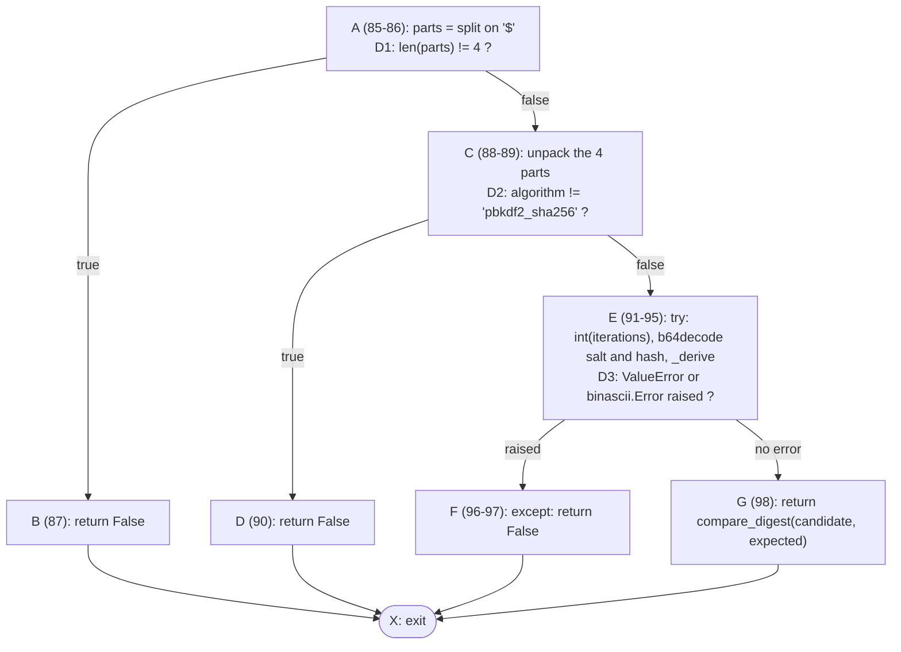

# White-box analysis: `verify_password` (Danish Ahmed, M2 SE431)

Method under test: `verify_password(password, stored_hash)` in `app/users/security.py`, lines 77–98
(commit `1083316`). It decides whether a login password matches the stored PBKDF2 hash. It is a
security-critical method (FR-01, QR-04) and must return `False`, never raise, for a malformed stored
hash, so it has several early exits.

## 1. Source with line numbers

```python
 85     parts = stored_hash.split("$")
 86     if len(parts) != 4:                                   # D1
 87         return False
 88     algorithm, iterations_text, salt_b64, hash_b64 = parts
 89     if algorithm != HASH_ALGORITHM:                       # D2
 90         return False
 91     try:
 92         iterations = int(iterations_text)
 93         salt = base64.b64decode(salt_b64, validate=True)
 94         expected = base64.b64decode(hash_b64, validate=True)
 95         candidate = _derive(password, salt, iterations)
 96     except (ValueError, binascii.Error):                  # D3
 97         return False
 98     return hmac.compare_digest(candidate, expected)
```

## 2. Decision nodes

| Id | Line | Predicate | True branch | False branch |
|---|---|---|---|---|
| D1 | 86 | `len(parts) != 4` | return False (87) | line 88 |
| D2 | 89 | `algorithm != "pbkdf2_sha256"` | return False (90) | try block (91) |
| D3 | 96 | the try block (92–95) raised `ValueError` or `binascii.Error` | return False (97) | line 98 |

The try block is one basic block whose outcome is a two-way decision (raised / not raised). Three
statements in it can raise: `int()` on line 92 (non-numeric count), `b64decode` on lines 93–94
(invalid base64), and `_derive` on line 95 (`hashlib` raises `ValueError` when iterations < 1). All
three leave the block by the same edge to the `except` node. `hmac.compare_digest` on line 98 is a
call whose result is returned, not a branch inside this method.

## 3. Control-flow graph



Nodes: A, B, C, D, E, F, G, X, so N = 8.
Edges: A→B, A→C, B→X, C→D, C→E, D→X, E→F, E→G, F→X, G→X, so E = 10.

## 4. Cyclomatic complexity

| Method | Working | V(G) |
|---|---|---|
| Edges and nodes | E − N + 2 = 10 − 8 + 2 | **4** |
| Decisions | P + 1 = 3 (D1, D2, D3) + 1 | **4** |
| Regions | R1 bounded by A→B→X and A→C→D→X; R2 by C→D→X and C→E→F→X; R3 by E→F→X and E→G→X; R4 the outer region | **4** |
| Radon (tool) | `radon cc app -s -a` reports `F 77:0 verify_password - A (4)` | **4** |

All four agree. V(G) = 4 is within the project limit of 10 (QR-06), and Radon grades it A.

## 5. Basis paths and covering tests

Baseline path P4 is the normal successful flow; P1–P3 each flip one decision of the baseline
(McCabe's baseline method), so the four paths are linearly independent and V(G) = 4 of them suffice.

| Path | Nodes | Decision outcomes | Input (stored hash) | Expected | Covering test in `tests/users/test_security.py` |
|---|---|---|---|---|---|
| P1 | A→B→X | D1 true | `pbkdf2_sha256$600000$onlythreeparts` (3 parts) | `False` | `test_verify_returns_false_for_wrong_number_of_parts` |
| P2 | A→C→D→X | D1 false, D2 true | `md5$600000$<salt>$<hash>` | `False` | `test_verify_returns_false_for_unknown_algorithm` |
| P3 | A→C→E→F→X | D1 false, D2 false, D3 true | `pbkdf2_sha256$many$<salt>$<hash>` | `False` | `test_verify_returns_false_for_non_numeric_iterations` |
| P4 | A→C→E→G→X | D1 false, D2 false, D3 false | a real hash of `"secret"`, password `"secret"` | `True` | `test_verify_accepts_the_correct_password` |

Additional tests beyond the basis set:

| Test | Path | Why it is kept |
|---|---|---|
| `test_verify_rejects_a_wrong_password` | P4, `compare_digest` returns False | Same path, opposite result: proves P4 does not always return True |
| `test_verify_returns_false_for_zero_iterations` | P3, raised on line 95 | Exercises the third raising statement (`_derive`); it was the reason `_derive` sits inside the try |
| `test_verify_returns_false_for_invalid_base64` | P3, raised on line 93 | Exercises the `binascii.Error` exception type named in D3 |

## 6. Evidence

`python -m pytest tests/users/test_security.py -v --cov=app.users.security --cov-branch` on
18 Nov 2026: 14 passed; `app/users/security.py` 97% statement and branch coverage. The only missed
line is 53 (`_load_secret` when `CFBS_SECRET` is set), outside `verify_password`; every statement and
both outcomes of D1, D2 and D3 in `verify_password` are covered.

Test-first history for this method: tests in `85124bd` (red: module missing), implementation in
`1083316` (green). The analysis needed no new tests, because every basis path already had one.
