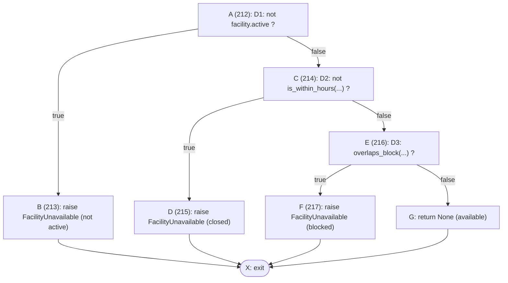

# White-box analysis: `BookingService._check_available` (Muhammad Hussnain Abbas, M2 SE431)

Method under test: `BookingService._check_available(facility, start, end)` in
`app/bookings/service.py`, lines 210-217 (commit `5effde2`). It is the availability check that
`request_booking` (FR-04, FR-05) and `confirm_pending` (FR-08) run before any booking is confirmed:
the facility must be active, open for the whole interval and free of maintenance blocks. It is the
most complex method in `app/bookings` by Radon (A, 4).

## 1. Source with line numbers

```python
210     def _check_available(self, facility: FacilityInfo, start: datetime, end: datetime) -> None:
211         """Raise FacilityUnavailable if the facility is inactive, closed or blocked then."""
212         if not facility.active:                                                     # D1
213             raise FacilityUnavailable(f"Facility {facility.id} is not active")
214         if not self._facilities.is_within_hours(facility.id, start, end):           # D2
215             raise FacilityUnavailable(f"Facility {facility.id} is closed at that time")
216         if self._facilities.overlaps_block(facility.id, start, end):                # D3
217             raise FacilityUnavailable(f"Facility {facility.id} is blocked for maintenance")
```

## 2. Decision nodes

| Id | Line | Predicate | True branch | False branch |
|---|---|---|---|---|
| D1 | 212 | `not facility.active` | raise (213) | line 214 |
| D2 | 214 | `not is_within_hours(facility.id, start, end)` | raise (215) | line 216 |
| D3 | 216 | `overlaps_block(facility.id, start, end)` | raise (217) | normal return |

`is_within_hours` and `overlaps_block` are calls through the `FacilityLookup` Protocol whose
boolean results drive D2 and D3; they are not branches inside this method. A `raise` leaves the
method, so each raise node has an edge to the exit.

## 3. Control-flow graph



Nodes: A, B, C, D, E, F, G, X, so N = 8.
Edges: A→B, A→C, B→X, C→D, C→E, D→X, E→F, E→G, F→X, G→X, so E = 10.

## 4. Cyclomatic complexity

| Method | Working | V(G) |
|---|---|---|
| Edges and nodes | E − N + 2 = 10 − 8 + 2 | **4** |
| Decisions | P + 1 = 3 (D1, D2, D3) + 1 | **4** |
| Regions | R1 bounded by A→B→X and A→C→D→X; R2 by C→D→X and C→E→F→X; R3 by E→F→X and E→G→X; R4 the outer region | **4** |
| Radon (tool) | `python -m radon cc app/bookings/service.py -s` reports `M 210:4 BookingService._check_available - A (4)` | **4** |

All four agree. V(G) = 4 is within the project limit of 10 (QR-06). Keeping the checks in this
small private method is what keeps `request_booking` at complexity 2.

## 5. Basis paths and covering tests

Baseline path P4 is the normal "available" flow; P1-P3 each flip one decision of the baseline
(McCabe's baseline method). Tests use the fakes in `tests/bookings/fakes.py`: `FakeLookup` with
`open` and `blocked` flags, and the facility `CLOSED_ROOM` (`active=False`).

| Path | Nodes | Decision outcomes | Input | Expected | Covering test in `tests/bookings/test_booking_service.py` |
|---|---|---|---|---|---|
| P1 | A→B→X | D1 true | facility `CLOSED_ROOM` (inactive) | `FacilityUnavailable`, nothing stored | `test_inactive_facility_is_unavailable` |
| P2 | A→C→D→X | D1 false, D2 true | active lab, `lookup.open = False` | `FacilityUnavailable`, nothing stored | `test_outside_operating_hours_is_unavailable` |
| P3 | A→C→E→F→X | D1 false, D2 false, D3 true | active lab, open, `lookup.blocked = True` | `FacilityUnavailable`, nothing stored | `test_overlapping_a_maintenance_block_is_unavailable` |
| P4 | A→C→E→G→X | D1 false, D2 false, D3 false | active lab, open, not blocked, free slot | returns; booking CONFIRMED | `test_free_slot_is_confirmed_with_history_and_event_after_commit` |

Additional tests that reach the same paths through `confirm_pending` (FR-08 recheck):

| Test | Path | Why it is kept |
|---|---|---|
| `test_confirm_pending_on_a_deactivated_facility_is_unavailable` | P1 | Facility deactivated after the request: approval must recheck |
| `test_confirm_pending_on_a_blocked_facility_is_unavailable` | P3 | Block added after the request: approval must recheck |
| `tests/bookings/test_booking_api.py::test_outside_hours_returns_409` | P2 | Same path through the real `SqlFacilityLookup` and the HTTP layer (409) |

## 6. Evidence

`python -m pytest tests/bookings/test_booking_service.py --cov=app.bookings.service --cov-branch
--cov-report=term-missing` on 19 Nov 2026: 30 passed; `app/bookings/service.py` 97% statement and
branch coverage, 0 partial branches. The missed lines (147, 151-152, 156) are `list_for_user`,
`history` and `schedule`, which are covered by the API tests instead; every statement and both
outcomes of D1, D2 and D3 in `_check_available` are covered.

Test-first history: tests in `fbfd52b` (red: `No module named 'app.bookings.service'`),
implementation in `e5fde83` (green). The analysis needed no new tests, because every basis path
already had one.
